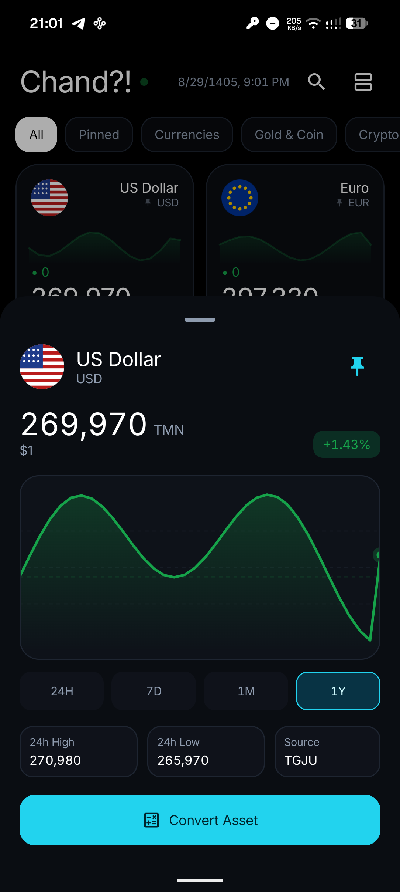
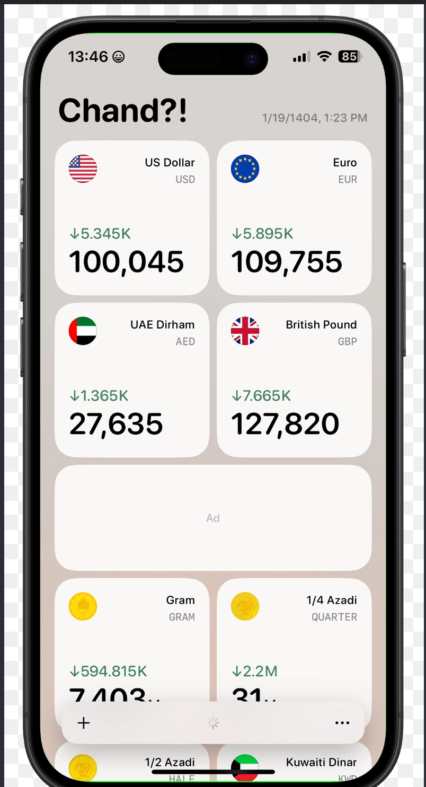
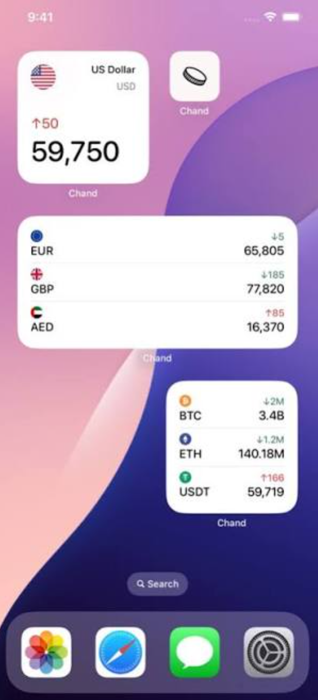
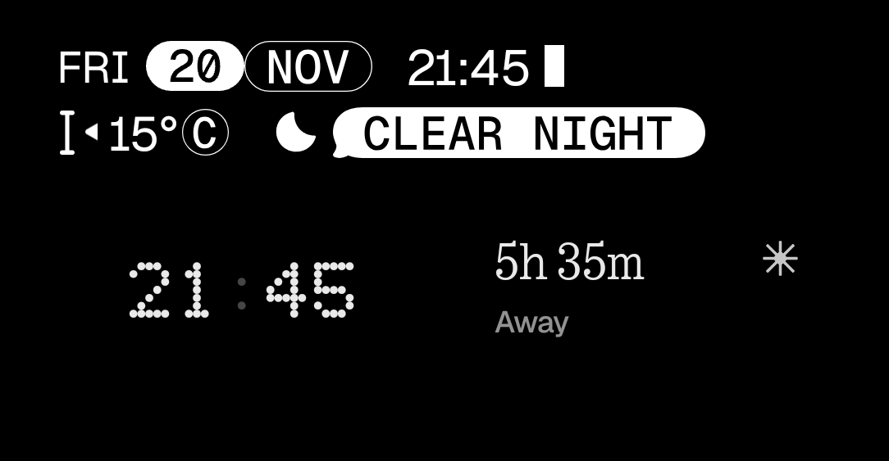

# Chand?! (`ir.thepoo7an.chand`)

**AMOLED live currency, gold & crypto tracker in Iranian Toman** — built natively for Android with **Kotlin**, **Jetpack Compose**, **Material 3**, and **Jetpack Glance**.

[](../../actions/workflows/release-apk.yml)

---

## Overview

**Chand?!** brings clean, real-time Iranian market rates to your home screen and lock screen with a pure `#000000` AMOLED-first interface, multi-provider live pricing, real historical trend charts (with Jalali dates), a fast built-in converter, and ultra-lightweight (~1.8 MB) release APKs.

- **Package / Application ID:** `ir.thepoo7an.chand`
- **Minimum Android:** Android 7.0 (API 24) • **Target SDK:** Android 16+ (API 36)

---

## Screenshots & Design Reference

| Live App (AMOLED & Interactive 1Y Chart) | Market Bento Grid Concept | Home Widgets Concept | Lock Screen Monochrome Inspiration |
| :---: | :---: | :---: | :---: |
|  |  |  |  |

---

## Download Latest APK

Grab the latest automated release builds from **[GitHub Releases](https://github.com/thepoo7an/chand/releases/latest)** *(update the URL if your repository slug differs)*:

| Build Variant | Recommended For | Direct Filename |
| :--- | :--- | :--- |
| **`arm64-v8a`** *(Recommended)* | Modern 64-bit Android phones (Android 10–17) | `Chand-arm64-v8a-release.apk` |
| **`armeabi-v7a`** | Older 32-bit Android devices | `Chand-armeabi-v7a-release.apk` |
| **`universal`** | Works on all CPU architectures | `Chand-universal-release.apk` |

> **Updating cleanly:** Make sure you install the same ABI variant signed with the repository's configured upload keystore so Android updates in-place without requiring uninstalling first.

---

## Key Features

- **Multi-Source Live Market Feeds**
  - Aggregates real-time quotes across **TGJU**, **Wallex**, **Bitpin**, **Nobitex**, **Binance**, **Frankfurter (ECB)**, **Currency-API**, and **Gold-API** for fiat currencies (USD, EUR, AED, GBP, TRY, KWD, SAR, IQD...), 18K/24K Gold & Iranian Coins (Emami, Bahar Azadi, Half, Quarter, Gerami), and cryptocurrencies (BTC, ETH, USDT, TON, SOL, BNB, XRP, DOGE).
- **Real Historical Charts (`24H` / `7D` / `1M` / `1Y`)**
  - Interactive touch scrubbing with exact Jalali timestamps, range high/low stats, and source attribution powered by real exchange & central-bank time series.
- **Home & Lock Screen Widgets (Jetpack Glance)**
  - **1×1 Hero Rate Widget** (US Dollar)
  - **2×1 Compact Glass Widget** (USD, EUR & 18K Gold with **Translucent Glass** & opacity presets: `50%`, `70%`, `85%`)
  - **4×2 Live Watchlist Widget** (EUR, GBP, AED)
  - **2×2 Crypto Widget** (BTC, ETH, USDT)
  - **Transparent Lock Screen Widget** (`keyguard|home_screen`, monochrome background-free style)
- **Instant Connectivity Widget Sync**
  - Automatically detects offline-to-online network transitions via `ConnectivityManager.NetworkCallback` and a system `JobScheduler` fallback (`WidgetConnectivityJobService`) so widgets refresh the moment your device connects to the internet.
- **In-App GitHub Release Update Checker**
  - Checks your configured GitHub Releases (`BuildConfig.GITHUB_REPOSITORY` or custom `owner/repo` in Settings), matches your device's CPU ABI, and opens the direct release APK in the browser with zero extra install permissions.
- **AMOLED Dark, Slate Dark & Light Themes + Bilingual UI**
  - Pure `#000000` AMOLED default theme alongside Dark & Light modes, 2-column Bento grid or list view, custom currency converter keypad, Jalali header clock, and full **English (LTR)** / **Persian (RTL)** + optional Persian digits (`۱۲۳`).
- **Compact APK Size (~1.8 MB)**
  - R8 full-mode shrinking & resource shrinking, PNG crunching, Moshi KSP codegen (`kotlin-reflect`-free), and `en`/`fa` locale filtering.

---

## Building from Source

### Prerequisites
- **JDK 21** (Temurin / OpenJDK)
- **Android SDK** with **Compile SDK 36** (`compileSdk 36`, `minSdk 24`, `targetSdk 36`)
- **Gradle 9.3.1** (installed on `PATH`)

### Local Commands

1. **Run Unit & Robolectric Tests**
   ```bash
   gradle :app:testDebugUnitTest
   ```

2. **Build Debug APK**
   ```bash
   gradle :app:assembleDebug
   ```

3. **Build Shrunk Release APKs (Universal + `arm64-v8a` + `armeabi-v7a`)**
   ```bash
   KEYSTORE_PATH=/path/to/your-upload-key.jks \
   STORE_PASSWORD=your_store_password \
   KEY_PASSWORD=your_key_password \
   gradle :app:assembleRelease -PenableAbiSplits=true
   ```
   Output APKs are generated in `app/build/outputs/apk/release/`.

### Automated GitHub Actions Releases
The workflow in `.github/workflows/release-apk.yml` automatically runs unit/Robolectric tests, increments `versionCode` from `github.run_number` (and `versionName` from git `v*` tags or `1.0.<run_number>`), builds all three ABI APKs (`universal`, `arm64-v8a`, `armeabi-v7a`), and publishes a GitHub Release on every push to `main`/`master` or `v*` tag.

To ensure updates install smoothly over previous releases, add these three secrets in **GitHub Repository → Settings → Secrets and variables → Actions** (key alias must be `upload`):
- `KEYSTORE_BASE64`
- `STORE_PASSWORD`
- `KEY_PASSWORD`

---

## Tech Stack

- **Language:** Kotlin + Coroutines & Flow
- **UI:** Jetpack Compose, Material 3, Navigation Compose (Type-Safe Routes), Jetpack Glance AppWidgets
- **Networking & Serialization:** Retrofit 2, OkHttp, Moshi KSP Codegen, Kotlinx Serialization
- **Persistence:** Jetpack DataStore Preferences
- **Testing:** JUnit 4, Robolectric, Compose UI Test
